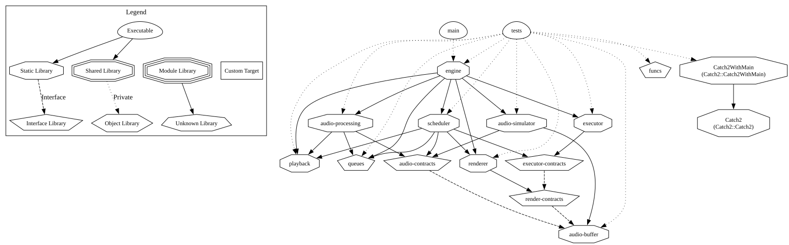
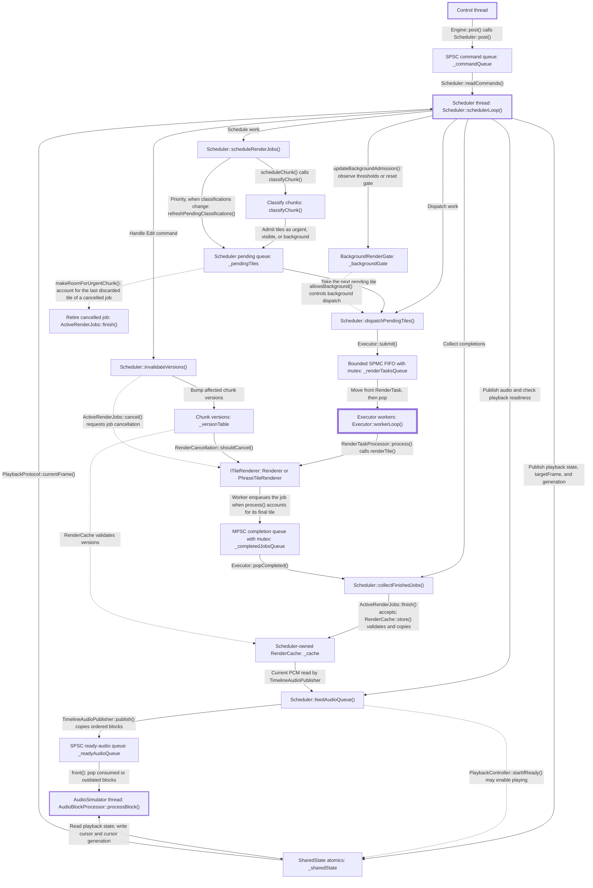

# ANASA - Asynchronous Neural Audio Scheduling Architecture

> Work in progress

A C++ experimental prototype for studying how to schedule computationally expensive audio rendering ahead of playback on a finite audio timeline. It supports DAW-style controls such as play, pause, seek, region edits, and viewport changes.

The prototype uses a simulated periodic audio-device callback. It is not an audio host, plugin, or complete DAW.

The default engine renderer generates deterministic synthetic audio and artificial CPU load. The optional `OPENVPI` backend performs whole-phrase neural inference through `IPhraseRenderer`. `PhraseTileRenderer` adapts it to the existing `ITileRenderer` execution path. The runtime demo can run synthetic rendering, neural rendering, or both sequentially, and records the simulated callback output to WAV. `NN_BENCHMARK` separately builds the standalone inference benchmark.

The problem statement is the following:

Given limited rendering capacity and moving playback deadlines, which work should be rendered first to minimize active-playback underruns and interruption latency while supporting seeks, edits, viewport changes, and background preparation?

The project separates that problem into smaller components:

- Interchangeable tile renderers: deterministic synthetic work and an optional adapter for prepared singing phrases.
- A fixed worker pool that performs render work concurrently.
- A scheduler that classifies, orders, caches, and publishes rendered work.
- Lock-free Single-producer/single-consumer (SPSC) queues. They store commands and ready for consumption audio blocks.
- A simulated audio-device thread that consumes exact blocks and records underruns.
- An `Engine` that owns the complete pipeline and enforces its lifecycle.

Two scheduling strategies are implemented: FIFO ordering by tile submission sequence and deadline-aware priority ordering. Both modes classify work as urgent, visible, or background, and classification affects pending-queue capacity limits. Priority mode also uses low/high water thresholds to gate background dispatch while playback is requested.

## Architecture

ANASA is divided into small **CMake targets** with one-directional dependencies.



This graph shows the default build with `OPENVPI=OFF` and
`NN_BENCHMARK=OFF`. Optional ONNX targets are not included.

### Runtime communication



The diagram shows calls and data flow between runtime threads. Each normal
scheduler iteration reads commands, collects completed jobs, feeds the audio
queue, updates background admission, schedules jobs, and dispatches pending
tiles, then requests a 1 ms sleep.

Synthetic tiles can run on multiple executor workers. The neural demo uses
one worker and one whole phrase per job. `PhraseTileRenderer` calls
`IPhraseRenderer`, implemented by `OpenVpiRenderer`, on that worker. Both
renderers write `RenderJob::samples` before completion is published.
Thicker borders identify threads. The heavier border identifies the worker pool.

Priority changes affect `_pendingTiles`. Tasks already submitted to the
executor remain FIFO. Seeking changes playback urgency without automatically
cancelling already submitted work.

- **Command handling:** The control thread posts commands through `_commandQueue`. Scheduler processes them to update playback, viewport, and content state.
- **Work selection:** Scheduler classifies chunks as urgent, visible, or background and places their tiles in `_pendingTiles`. It refreshes classifications when playback or viewport changes require it. In Priority mode, low/high water thresholds control background dispatch while playback is requested. If urgent work cannot fit, Scheduler reclaims cancelled pending tiles and cancels lower-priority jobs, starting with the least important, to admit a complete urgent chunk. The pending-tile limit still applies. FIFO keeps its existing admission order.
- **Parallel rendering:** Selected tiles enter the bounded `_renderTasksQueue`. Workers take tasks and render separate regions of a shared `RenderJob::samples` buffer. Each tile is accounted for once: by a worker after submission, or by Scheduler if discarded before submission after cancellation. If a worker accounts for the final tile, it places the job in `_completedJobsQueue`. If Scheduler accounts for the final tile of a cancelled job, it retires that job directly. Jobs abandoned during shutdown may never produce a completion.
- **Completion and publication:** `collectFinishedJobs()` checks job identity, cancellation, and version before copying accepted samples into `_cache`. `feedAudioQueue()` copies cached samples into `_readyAudioQueue` as generation-tagged blocks in timeline order.
- **Audio consumption:** AudioBlockProcessor consumes blocks matching its current generation and expected position, discards outdated blocks, and reports playback progress through _sharedState. During active playback, a missing required block produces silence, reports an underrun, and advances the playback cursor. At the timeline end, callbacks produce silence without reporting further underruns or advancing the cursor, even before Scheduler clears playback permission.
- **Transport and invalidation:** Shared atomics communicate playback state, seek targets, generations, and cursor acknowledgements. Edits bump affected chunk versions so Renderer can abandon obsolete work and Scheduler can reject obsolete results.

Rendering may finish out of order, but audio publication remains ordered. Chunk versions identify valid content. Playback generations distinguish audio belonging to different playback sequences.

## Requirements

- CMake 3.22 or newer.
- A compiler and standard library supporting C++20.
- Build tools appropriate for the selected CMake generator:
  - Windows: Visual Studio or Visual Studio Build Tools with the
    "Desktop development with C++" workload.
  - Linux: GCC or Clang, with Make or Ninja.
  - macOS: Xcode Command Line Tools, with Make or Ninja.
- Graphviz, only when regenerating the dependency diagram.

When tests are enabled, CMake downloads Catch2 automatically.
This requires Git and internet access unless `CATCH2_LIB` points
to an existing local Catch2 source checkout. `CATCH2_LIB` is an environment variable, since the CMake root code reads $ENV{CATCH2_LIB}.

## Building and testing

Run these commands from the project root.

### Windows - Visual Studio generator

Configure once with tests enabled:

```powershell
cmake -B build -DBUILD_TESTS=ON -DBENCHMARKS=OFF
```

Build and run tests in **Release**:

```powershell
cmake --build build --config Release
```

and then

```powershell
ctest --test-dir build -C Release --output-on-failure
```

or

```powershell
.\build\tests\Release\tests.exe
```


Or build and run tests in **Debug**:

```powershell
cmake --build build --config Debug
```

and then

```powershell
ctest --test-dir build -C Debug --output-on-failure
```

or

```powershell
.\build\tests\Debug\tests.exe
```

These commands assume CMake selects a Visual Studio generator.

### Linux / macOS - Unix Makefiles or Ninja generator

Use separate build directories for Release and Debug.

Build and run tests in **Release**:

```sh
cmake -B build/release -DCMAKE_BUILD_TYPE=Release -DBUILD_TESTS=ON -DBENCHMARKS=OFF
```

```sh
cmake --build build/release
```

and then

```sh
ctest --test-dir build/release --output-on-failure
```

or

```sh
./build/release/tests/tests
```

Build and run tests in **Debug**:

```sh
cmake -B build/debug -DCMAKE_BUILD_TYPE=Debug -DBUILD_TESTS=ON -DBENCHMARKS=OFF
```

```sh
cmake --build build/debug
```

and then

```sh
ctest --test-dir build/debug --output-on-failure
```

or

```sh
./build/debug/tests/tests
```

### Build options

- `BUILD_TESTS=ON`: build the Catch2 tests.
- `BENCHMARKS=ON`: also enable benchmark cases: requires `BUILD_TESTS=ON`.
- `OPENVPI=ON`: build the TIGER v106 ONNX backend and enable neural runtime-demo modes. This requires `ONNXRUNTIME_ROOT`.
- `NN_BENCHMARK=ON`: build the standalone inference benchmark. This requires `OPENVPI=ON`.
  
To enable benchmarks, replace `-DBENCHMARKS=OFF` with
`-DBENCHMARKS=ON` in the configuration command, then rebuild.
Use Release for performance measurements.

Configuration selection follows the generator: ordinary Ninja on Windows
uses `CMAKE_BUILD_TYPE`. Xcode and Ninja Multi-Config use `--config`.

This project registers Catch2 test cases with CTest in `tests/CMakeLists.txt`:

```cmake
include(Catch)
catch_discover_tests(tests DISCOVERY_MODE PRE_TEST)
```

CTest command works across platforms without needing the executable's precise location, and CTest normally comes with CMake.

## Runtime demo

[`runtime-demo/main.cpp`](runtime-demo/main.cpp) starts
[`RuntimeDemo`](runtime-demo/RuntimeDemo.cpp), which compares FIFO and Priority
using the complete engine and simulated audio callback.

The `synthetic` mode defaults to five trials per policy. Neural modes require
an explicit trial count. Every trial creates a fresh engine, and the first
policy alternates between FIFO and Priority. A three-scenario suite with five
trials per policy runs 30 trials. `both` runs two such suites. The `listen`
mode instead runs one full-playback scenario per policy.

For model downloads, ONNX Runtime installation, and neural build/run commands,
see [Neural inference setup](InferenceSetup.md).

The demo supports synthetic rendering and optional OpenVPI neural inference. It records the simulated callback output to WAV, including preparation silence. It does not play directly through an audio device.

### Build and run

Run commands from the repository root. The executable target is currently named
`main`. It is included in the normal CMake build; no separate demo option or
`BENCHMARKS=ON` setting is required.

**Windows — Visual Studio generator**

```powershell
cmake -S . -B build -DBUILD_TESTS=OFF
cmake --build build --config Release --target main --parallel
.\build\runtime-demo\Release\main.exe synthetic
```

To save the output, use this command instead of the final command above:

```powershell
.\build\runtime-demo\Release\main.exe synthetic | Tee-Object -FilePath ".\build\runtime-demo-results.txt"
```

**Linux / macOS — Unix Makefiles or Ninja**

```sh
cmake -S . -B build/runtime-release -DCMAKE_BUILD_TYPE=Release -DBUILD_TESTS=OFF
cmake --build build/runtime-release --target main --parallel
./build/runtime-release/runtime-demo/main
```

Run `main --help` for mode arguments. `synthetic`, `neural`, and `both` run the seek, viewport, and edit comparisons. `listen` performs full neural timeline playback without edits:

`main listen <voicebank> <threads> <steps> <trials> <output-directory>`

Neural modes require a build configured with `OPENVPI=ON`.

### Configuration and scenarios

The default synthetic configuration uses:

| Setting | Value |
| --- | --- |
| Timeline | 12 seconds |
| Sample rate / channels | 48,000 Hz / 2 |
| Callback block | 128 frames, approximately 2.667 ms |
| Executor workers | 4 |
| Synthetic work iterations | 1,000 |
| Trials | 5 per policy, per scenario |
| Initial background preparation | 100 ms |
| Requested observation interval | 2,000 ms per trial |
| Recovery timeout | 10 seconds per recovery wait |

Other engine settings retain their defaults.

1. **Seek recovery under background backlog:** start the engine, allow 100 ms
   of background preparation, then seek to 6 seconds and request playback.
   After recovery is observed, wait for a further 2,000 ms.

2. **Viewport-guided seek preparation:** perform the same initial preparation,
   move the viewport to `[6 s, 8 s)`, and allow another 100 ms of preparation
   before seeking to 6 seconds and requesting playback. The reported recovery
   time excludes this additional viewport-preparation interval.

3. **Edit recovery during playback:** seek to 6 seconds and wait for recovery,
   wait another 1,000 ms, then invalidate approximately the `[7 s, 7.25 s]`
   region. Measure edit recovery and wait for a further 1,000 ms afterward.
   This edit changes the synthetic content version. It does not modify notes
   or lyrics.

Background preparation uses a fixed waiting interval, not a fixed number of
completed or queued jobs. The resulting backlog depends on machine performance
and thread scheduling.

### What the metrics measure

**Recovery time** starts immediately before posting the seek or edit command.
It ends when the control thread observes all three conditions:

- The playback generation has advanced.
- The audio cursor has acknowledged that generation.
- Playback permission is enabled (`playing == true`).

This measures observed playback readiness. It does not establish that the
first valid audio block of the new generation has already been consumed.
The observation loop requests 250-microsecond sleeps, but its actual wake-up
timing depends on the operating system.

**Median recovery** summarizes the configured trials per policy. **Worst recovery** is the
largest observed value, not a guaranteed upper bound.

**Callbacks** and **underruns** are summed across the configured trials per policy. The underrun
rate is:

```text
100 × total underruns / total counted callbacks
```

A counted callback is an active-playback callback. When its required audio
block is unavailable, the processor outputs silence, reports an underrun,
and advances the playback cursor. Paused and prebuffering callbacks are excluded.

Counters cover the complete engine trial. In the edit scenario, they include
playback before and after the edit, rather than only the recovery interval.

The console label `Active playback: 2000 ms` refers to requested wall-clock
observation waits. It is not a measured guarantee of exactly 2,000 ms of
uninterrupted playback.

**Maximum callback duration** measures elapsed time inside the simulated
callback, including capture and checksum work. It does not measure callback
start lateness, and the underrun counter is not a deadline-miss counter.

### Historical synthetic results

The following output is from the Windows Release run documented on `main`
at `af43e13`, before neural inference and callback recording were integrated.
These are illustrative measurements, not portable performance guarantees.

| Scenario | Policy | Median recovery (ms) | Maximum observed (ms) | Underruns / callbacks | Underrun rate |
| --- | --- | ---: | ---: | ---: | ---: |
| Seek recovery | FIFO | 668.57 | 685.88 | 3,178 / 3,768 | 84.34% |
| Seek recovery | Priority | 77.20 | 78.86 | 0 / 3,762 | 0.00% |
| Viewport-prepared seek | FIFO | 590.78 | 593.06 | 0 / 3,769 | 0.00% |
| Viewport-prepared seek | Priority | 31.24 | 31.88 | 0 / 3,779 | 0.00% |
| Edit recovery | FIFO | 577.17 | 620.28 | 2,633 / 3,827 | 68.80% |
| Edit recovery | Priority | 92.48 | 94.27 | 0 / 3,828 | 0.00% |

Priority scheduling produced lower median recovery times in all three scenarios
and no counted active-playback underruns in this run.

The viewport scenario also shows why recovery time and underruns must be reported
together: both policies recorded zero underruns, while their recovery times differed
substantially. Waiting before playback is enabled does not increase the underrun count.

This comparison covers the complete FIFO and Priority modes, including their
different background-admission and urgent-capacity behavior. It does not isolate
the effect of priority ordering alone.

Results depend on hardware, compiler, build configuration, operating-system
scheduling, and competing load. Record that information when comparing runs.
Five trials and a simulated callback do not establish audio-device latency,
hard real-time guarantees, or neural-inference performance.


## Continuous integration

The GitHub Actions workflow in `.github/workflows/ci.yml` runs:

- On pushes to any branch.
- On pull requests targeting `main`, `spsc`, or `nn-inference`.
- When manually triggered through the repository's Actions tab.

The core jobs configure and build Release with `BUILD_TESTS=ON`,
`BENCHMARKS=OFF`, and the default `OPENVPI=OFF` on Ubuntu, Windows,
and macOS. They run the registered Catch2 tests through CTest.
A failed matrix job does not cancel the other jobs.

A separate Windows job builds the runtime demo and standalone inference
benchmark with `OPENVPI=ON` and `NN_BENCHMARK=ON`. It downloads ONNX Runtime
1.31.1 and checks executable startup by running the demo with `--help`.

The OpenVPI job checks compilation, linking, and executable startup.
It does not download the voicebank or execute neural inference.

The runtime demo's timed scenarios and the standalone inference benchmark
are not executed by CI.

Results and logs are available under the **C++ CI** workflow in the
repository's Actions tab.

## Generating the dependency graph

The architecture diagram in `docs/dependencies.svg` shows CMake targets
and their dependencies. Regenerate it after changing targets or their
dependency relationships.

### Install Graphviz

Windows, using Windows Package Manager:

```powershell
winget install graphviz
```

Alternatively, use the Graphviz Windows installer.
Ensure its `bin` directory is on `PATH`, then reopen your terminal.

Ubuntu / Debian:

```sh
sudo apt update
sudo apt install graphviz
```

macOS, using Homebrew:

```sh
brew install graphviz
```

Verify that Graphviz is available:

```sh
dot -V
```

### Windows - PowerShell

Run from the project root:

```powershell
New-Item -ItemType Directory -Force build/dependency-graph | Out-Null

Copy-Item cmake/CMakeGraphVizOptions.cmake build/dependency-graph/CMakeGraphVizOptions.cmake

cmake -B build/dependency-graph -DBUILD_TESTS=ON -DBENCHMARKS=OFF --graphviz=build/dependency-graph/dependencies.dot

dot -Tsvg build/dependency-graph/dependencies.dot -o docs/dependencies.svg
```

### Linux / macOS

Run from the project root:

```sh
mkdir -p build/dependency-graph

cp cmake/CMakeGraphVizOptions.cmake build/dependency-graph/CMakeGraphVizOptions.cmake

cmake -B build/dependency-graph -DBUILD_TESTS=ON -DBENCHMARKS=OFF --graphviz=build/dependency-graph/dependencies.dot

dot -Tsvg build/dependency-graph/dependencies.dot -o docs/dependencies.svg
```

CMake generates the `.dot` dependency description.
Graphviz converts it into the SVG displayed in this README.
Compiling the project is not required.

The copied options file applies the project's graph settings.
These commands include test targets.

Intermediate files remain under `build/dependency-graph/`.
The generated diagram is written to `docs/dependencies.svg`.
